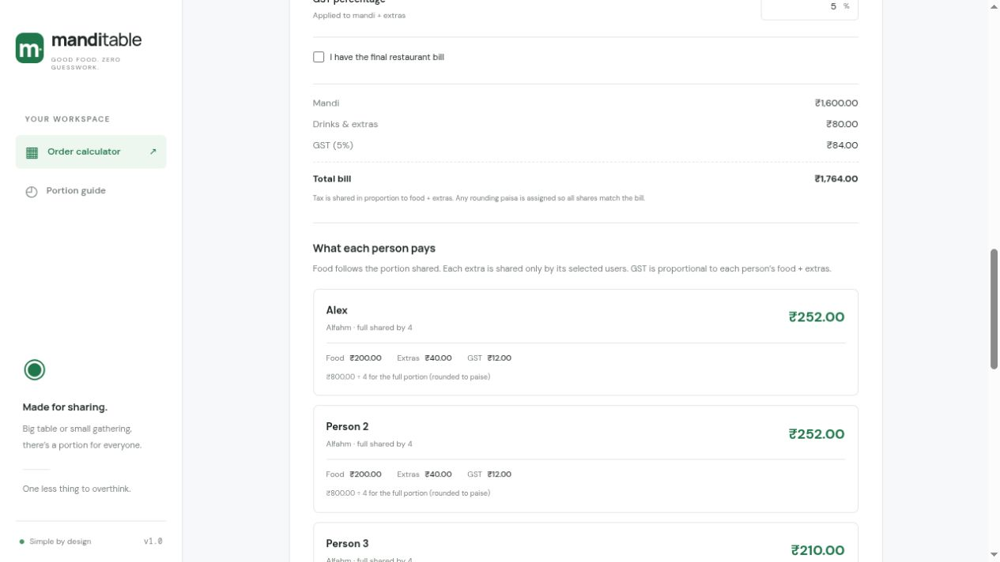

# Mandhi Calc · Mandi Table

**Plan the order. Pay for what you ate.**

[](https://github.com/Edson-Edwin/mandhi-calc/actions/workflows/test.yml)
[](LICENSE)
[](CONTRIBUTING.md)

A small, open-source mandi order and bill calculator built with HTML, CSS, and JavaScript. Choose flavors, work out the portions, and calculate what each person owes based on their food and the extras they shared.

No accounts, backend, build step, or application dependencies.

[Get started](#quick-start) · [How billing works](#how-billing-works) · [Contribute](CONTRIBUTING.md) · [Report a bug](https://github.com/Edson-Edwin/mandhi-calc/issues/new/choose)

## Preview

The example below shows individual food, extras, and GST charges. People who did not share Pepsi are not charged for it.



## Features

- **Five-step flow:** people → flavors → assign people → review order → split bill.
- **Flexible flavors:** Alfahm, Peri Peri, Classic, Honey Chilli, Smoky BBQ, or your own.
- **Exact portions:** full serves 4, half serves 2, quarter serves 1.
- **Separate portion prices:** each flavor can have its own full, half, and quarter prices.
- **Individual bills:** full price ÷ 4, half price ÷ 2, or quarter price for its consumer.
- **Shared extras:** add Pepsi, water, or other items and select exactly who used each one.
- **Flexible GST:** enter a percentage or a direct rupee amount.
- **Final-bill adjustment:** reconcile a restaurant total with individual itemized shares.
- **Copy and share:** separate order-only and detailed bill summaries.
- **Browser storage:** keep your plan, optional names, and theme on the same browser.
- **Responsive layout:** light and dark themes, with layouts for phones and desktops.

## Quick start

### Requirements

- Git to clone the repository.
- Python 3 for the included local server command, or any static HTTP server.
- Node.js 22 or newer and npm to run the convenience scripts and tests.
- A modern browser with JavaScript enabled.

```sh
git clone https://github.com/Edson-Edwin/mandhi-calc.git
cd mandhi-calc
npm start
```

Open **[localhost:4173](http://localhost:4173)**. Stop the server with `Ctrl+C`.

There are no packages to install, so `npm install` is unnecessary. Without Node.js, serve the app directly:

```sh
python3 -m http.server 4173 --bind 127.0.0.1 --directory dist
```

Use an HTTP server rather than opening `index.html` directly: the app uses JavaScript modules. If port 4173 is busy, choose another port in the Python command.

## Using the calculator

1. **Enter the group size.** Choose a preset or enter a whole number from 1 to 999.
2. **Select flavors.** Pick one or more varieties or add a custom name.
3. **Assign people.** Each selected flavor needs at least one person, and the counts must match the group size. “Split evenly” distributes people across flavors; it does not average their bills.
4. **Review the order.** The calculator shows the full, half, and quarter portions needed for each flavor. Copy this list for the restaurant.
5. **Build the bill.** Enter portion prices, optionally name each consumer, add extras, select their users, and enter GST. Review or copy each person's bill.

Missing prices or extras without selected users keep individual totals pending. Enter `0` explicitly for a free item, or remove an extra you did not order.

## How billing works

Portions are calculated separately for each flavor, using full portions first, followed by halves and quarters. For example, **7 people = 1 full + 1 half + 1 quarter**.

| Component | Calculation |
| --- | --- |
| Full portion | Its price shared by its 4 consumers |
| Half portion | Its price shared by its 2 consumers |
| Quarter portion | Its price charged to its 1 consumer |
| Extra | Quantity × unit price, shared only by selected users |
| GST percentage | Applied to food + extras; allocated proportionally to individual subtotals |
| Direct GST amount | Added once; allocated proportionally to individual subtotals |
| Final restaurant bill | Difference from the itemized total allocated proportionally to individual shares |

Prices are in **INR (₹)**. The app does not choose a GST rate. A final restaurant bill already includes tax and extras; tax is not added a second time. Item prices and extras users are still needed to allocate that final amount.

Money is allocated in whole paise. Rounding remainders are distributed so individual totals add up exactly to the bill.

### Example: seven people, one flavor

Suppose the full costs ₹800, the half ₹500, and the quarter ₹300. Two of the four full-portion consumers share two ₹40 Pepsis. GST is 5%.

| People | Food each | Extras each | GST each | Total each |
| --- | ---: | ---: | ---: | ---: |
| 2 full-portion consumers who drank Pepsi | ₹200.00 | ₹40.00 | ₹12.00 | ₹252.00 |
| 2 full-portion consumers without Pepsi | ₹200.00 | ₹0.00 | ₹10.00 | ₹210.00 |
| 2 half-portion consumers | ₹250.00 | ₹0.00 | ₹12.50 | ₹262.50 |
| 1 quarter-portion consumer | ₹300.00 | ₹0.00 | ₹15.00 | ₹315.00 |

**Total: ₹1,764.00**, including ₹1,600 food, ₹80 Pepsi, and ₹84 GST.

## Development

```sh
npm test
node --check dist/app.mjs
node --check dist/calculator.mjs
```

Tests cover serving sizes, invalid counts, portion-specific pricing, extras attribution, both GST modes, final-bill reconciliation, incomplete inputs, and exact paise allocation. GitHub Actions runs the tests on Node.js 22 and 24 for pushes and pull requests.

| Path | Purpose |
| --- | --- |
| `dist/index.html` | Page structure and guided steps |
| `dist/styles.css` | Themes, components, and responsive layouts |
| `dist/app.mjs` | Interactions, browser storage, and presentation |
| `dist/calculator.mjs` | Portion and billing calculations |
| `tests/calculator.test.mjs` | Calculation tests using Node's built-in test runner |
| `docs/previews/` | Project screenshots, including earlier interface iterations |
| `.github/` | CI, issue forms, and pull request template |
| `.openai/hosting.json` | Existing owner's optional Sites deployment configuration |

Despite its name, `dist/` contains the editable application source. There is no separate build output. The package is marked `private` to prevent accidental npm publication; the source is publicly available under MIT.

## Hosting and data

Serve `dist/` on any static host. No environment variables or server-side services are required. You do not need the existing owner's Sites configuration to run or host your own copy.

For Vercel, import this repository with the repository root as the project root. The included `vercel.json` selects the Other framework preset, skips installation and building, and serves `dist/` as the output directory. This makes `dist/index.html` available at `/`. Add your custom domain in the project's Domains settings after deploying.

Plans, names, and extra selections are stored in `localStorage` on your browser. They are not synchronized between devices or browser origins. Clearing site data removes the saved plan. The app has no analytics or application backend; fonts are requested from Google Fonts, with system-font fallbacks. Copying uses the browser clipboard when available and otherwise offers a selectable text summary.

## Contributors

Created and maintained by **[Edson Edwin Ninan (@Edson-Edwin)](https://github.com/Edson-Edwin)**.

See [CONTRIBUTORS.md](CONTRIBUTORS.md) for project credits and the [GitHub contributors graph](https://github.com/Edson-Edwin/mandhi-calc/graphs/contributors) for code contributions. Bug reports, documentation, accessibility feedback, design improvements, and code contributions are welcome.

Please read [CONTRIBUTING.md](CONTRIBUTING.md) and our [Code of Conduct](CODE_OF_CONDUCT.md) before participating. For security concerns, see [SECURITY.md](SECURITY.md).

## License

[MIT](LICENSE) © 2026 Edson Edwin Ninan. You may use, modify, and redistribute the software under the license terms.
